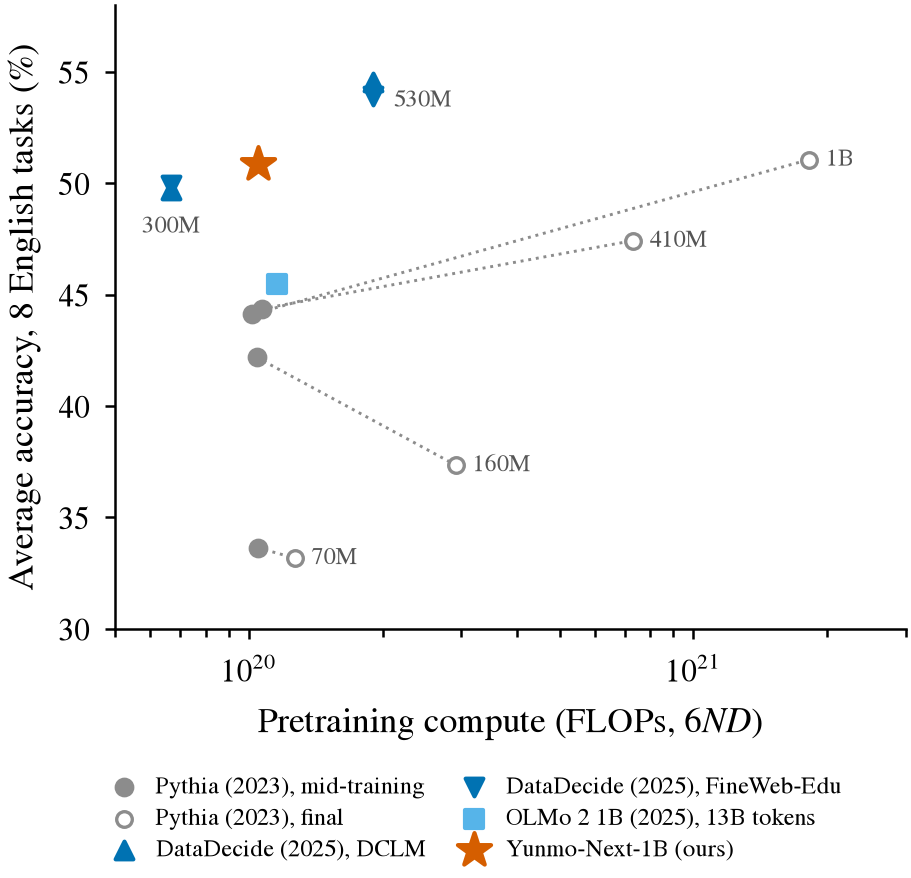
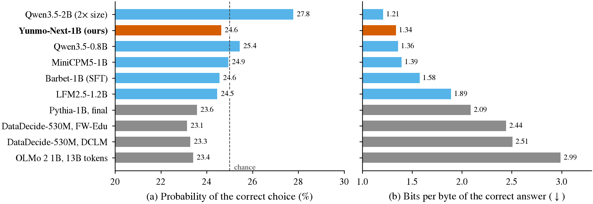
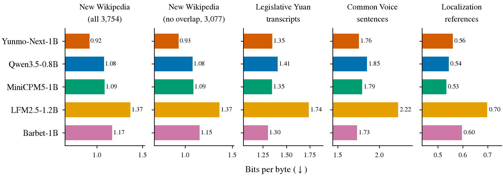
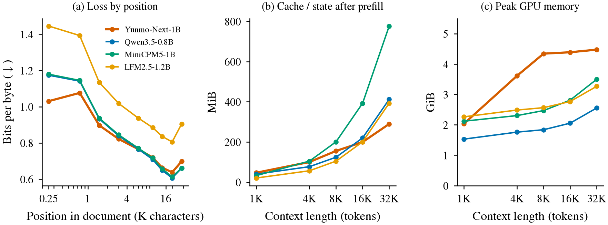
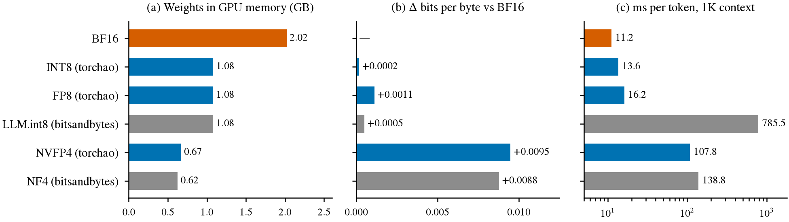

# Evaluating Yunmo-Next-1B-Base

*Technical report · Yunmo-Next-1B · October 2026*

## Summary

We compare Yunmo-Next-1B-Base with five open base models released in 2026, on 13 tasks run through one
harness with identical settings. Yunmo-Next was trained on 19.76B tokens; the one comparison model that
states its budget (LFM2.5-1.2B) was trained on 28T, about 1,400 times more.

- On English reasoning and knowledge tasks Yunmo-Next trails the comparison models, typically by 5–25
  points; the exception is OpenBookQA, where it is within noise of Qwen3.5-0.8B and MiniCPM5-1B (34.4 vs
  35.4 and 33.8) and 4.6 points behind LFM2.5-1.2B.
- On letter-scored multiple-choice knowledge tests (MMLU, TMMLU+) it is at chance level.
- On three Chinese cloze tasks it is 0.5–4.1 points behind the 0.8–1.1B models, ahead of LFM2.5-1.2B on two
  of them, and 5–10 points behind the 2B models.

At equal pretraining compute (about 10²⁰ FLOPs) the picture is different (§1.5–1.6): on the average of eight
English tasks Yunmo-Next (50.9) is ahead of every Pythia checkpoint and of an OLMo 2 checkpoint at the same
compute, and between the annealed 300M and 530M DataDecide models of 2025, whose compute brackets its own
(49.7–49.9 and 53.9–54.6). In cloze form (§1.7), TMMLU+ shows no knowledge beyond chance for any model of
1.2B parameters or fewer, by accuracy or by the normalized probability of the correct answer; Yunmo-Next gives
the answer text the lowest bits per byte, which mostly reflects how well it predicts Traditional Chinese.

On Traditional Chinese Wikipedia articles written after every model's training data, it predicts the text
better than all other compared models, including the 2B models (§2). This result is partly home ground: on three
non-Wikipedia Traditional Chinese corpora it is level with MiniCPM5-1B and behind OpenFormosa's Barbet-1B on
two of them (§2.5). Overlap with our Wikipedia training data explains only a small part (§2.4).

We also report long-context loss and memory against the comparison models (§3.4), the quality and speed of
quantized weights (§6), and internal measurements.

## 1. Comparison with 2026 open base models

### 1.1 Setup

| Setting | Value |
|---|---|
| Harness | lm-evaluation-harness 0.4.13, default task definitions |
| Shots | 0-shot, except MMLU 5-shot |
| Seed | 1234 for sampling few-shot examples |
| Metric | normalized accuracy (`acc_norm`) for ARC, HellaSwag, PIQA, OpenBookQA and SciQ; accuracy otherwise |
| Comparison models | Hugging Face `transformers` backend, BF16, batch size 4 |
| Yunmo-Next | a small harness adapter over the release package, FP32 |

The adapter scores exactly what completion mode would see: `<|bos|>` followed by context and continuation,
using the harness's own context/continuation split. Batches are right-padded to a multiple of 256 tokens;
because every layer is causal, padding after a sequence cannot change its scores, which we verified by
changing the pad token.

Yunmo-Next is evaluated in FP32, the release precision, rather than BF16. In BF16 the log-likelihood of a
short answer moved by up to 0.15 nats when only the padded batch width changed, while in FP32 it moved by
0.007. This numerical sensitivity is a property of the model in BF16 and is discussed in §5.

TMMLU+ runs 0-shot because some of its subjects have only four development examples, too few for 5-shot.

### 1.2 Models

| Model | Released | Parameters | Pretraining tokens |
|---|---|---:|---|
| **Yunmo-Next-1B-Base** | 2026-10 | 1.01B | 0.0198T |
| Qwen3.5-0.8B-Base | 2026-02 | 0.87B | not stated |
| LFM2.5-1.2B-Base | 2026-01 | 1.17B | 28T |
| MiniCPM5-1B-Base | 2026-05 | 1.08B | not stated |
| Qwen3.5-2B-Base | 2026-02 | 2.27B | not stated |
| MiniCPM5-2B-Base | 2026-08 | 2.52B | not stated |

Parameter counts are the checkpoints' totals. The Qwen3.5 checkpoints are vision-language models trained
on multimodal tokens and were scored text-only. AI2's `Dense_1b_130B`, which would have been the closest
comparison by token budget (130B), could not be evaluated: its custom model code targets transformers 4.57
and fails to load under transformers 5.

### 1.3 Results

| Task | Yunmo-Next 1B | Qwen3.5 0.8B | LFM2.5 1.2B | MiniCPM5 1B | Qwen3.5 2B | MiniCPM5 2B |
|---|---:|---:|---:|---:|---:|---:|
| ARC-Easy | 50.3 | 67.2 | 77.7 | 65.6 | 71.4 | 74.7 |
| ARC-Challenge | 29.2 | 40.1 | 51.3 | 37.3 | 45.9 | 50.5 |
| HellaSwag | 41.3 | 54.9 | 59.2 | 56.8 | 66.0 | 67.3 |
| PIQA | 65.9 | 71.8 | 73.3 | 72.7 | 74.8 | 77.0 |
| Winogrande | 56.1 | 60.2 | 58.7 | 58.2 | 64.6 | 63.5 |
| OpenBookQA | 34.4 | 35.4 | 39.0 | 33.8 | 37.6 | 41.8 |
| SciQ | 85.2 | 91.7 | 93.3 | 92.3 | 93.2 | 93.9 |
| LAMBADA (OpenAI) | 44.5 | 50.9 | 46.6 | 55.4 | 58.4 | 61.2 |
| MMLU (5-shot) | 22.9 | 48.4 | 55.0 | 43.5 | 54.0 | 65.3 |
| TMMLU+ | 25.0 | 31.2 | 31.2 | 28.4 | 42.1 | 44.1 |
| XStoryCloze-zh | 57.5 | 58.3 | 58.5 | 58.0 | 62.3 | 63.6 |
| XCOPA-zh | 61.8 | 63.4 | 60.8 | 62.4 | 67.8 | 67.0 |
| XWinograd-zh | 67.5 | 68.8 | 63.1 | 71.6 | 77.4 | 74.6 |

Standard errors are about 1 point on ARC-Easy and larger on the smaller sets (OpenBookQA 500 items,
XCOPA-zh 500, XWinograd-zh 504, XStoryCloze-zh 1,511); differences of 2–3 points on those sets are within
noise. LAMBADA perplexity: Yunmo-Next 36.9, Qwen3.5-0.8B 11.7, LFM2.5 13.5, MiniCPM5-1B 8.7, Qwen3.5-2B 7.2,
MiniCPM5-2B 6.2.

### 1.4 Reading the results

- **Token budget dominates.** With roughly three orders of magnitude fewer training tokens than LFM2.5, the
  gap on English commonsense and science tasks is the expected outcome, not evidence about the architecture
  either way. The comparison shows where this checkpoint stands; §1.5 compares at equal compute.
- **Multiple-choice knowledge.** MMLU and TMMLU+ ask the model to put probability on the letter of the right
  answer. Yunmo-Next scores at chance on both, in this harness and in the internal 5-shot evaluation
  (TMMLU+ 25.1%, MMLU 24.2%). The comparison models score 28–65%.
- **Chinese cloze.** On XStoryCloze, XCOPA and XWinograd (Simplified Chinese), Yunmo-Next is 0.8–1.6
  points below Qwen3.5-0.8B, ahead of LFM2.5-1.2B on XCOPA (+1.0) and XWinograd (+4.4), and 4.1 points behind
  MiniCPM5-1B on XWinograd. These tasks score whole-sentence plausibility, which a model can do from language
  modeling alone. Yunmo-Next's training data is mostly Traditional Chinese; these sets are Simplified.
- **No Traditional Chinese cloze benchmark** of comparable standing was available in the harness. §1.7 adds
  a cloze form of TMMLU+, and §2 compares the models directly on new Traditional Chinese text.

### 1.5 Same compute: Pythia checkpoints

LFM2.5-1.2B, the one model above that states its token count, used about 1,900 times Yunmo-Next's compute;
the others do not state their budgets. To compare at equal compute we first used Pythia, a model suite that
publishes intermediate checkpoints for several sizes trained on the
same data in the same order (The Pile, 2,097,152 tokens per step). For each size we took the checkpoint
closest to Yunmo-Next's pretraining compute of about 1.05×10²⁰ FLOPs (6 × parameters × tokens; total
parameters for Pythia, each growth stage's own count for Yunmo-Next), and added the final Pythia-1B for reference. Same harness and settings as §1.1, BF16.

| Model | Parameters | Tokens | Compute (FLOPs) |
|---|---:|---:|---:|
| **Yunmo-Next-1B-Base** | 1.01B | 19.8B | 1.05×10²⁰ |
| Pythia-70M, step 118,000 | 0.07B | 247B | 1.05×10²⁰ |
| Pythia-160M, step 51,000 | 0.16B | 107B | 1.04×10²⁰ |
| Pythia-410M, step 21,000 | 0.41B | 44B | 1.07×10²⁰ |
| Pythia-1B, step 8,000 | 1.01B | 16.8B | 1.02×10²⁰ |
| Pythia-1B, final (step 143,000) | 1.01B | 300B | 1.82×10²¹ |

| Task | Yunmo-Next 1B | Pythia 70M | Pythia 160M | Pythia 410M | Pythia 1B @8k | Pythia 1B final |
|---|---:|---:|---:|---:|---:|---:|
| ARC-Easy | **50.3** | 32.5 | 40.4 | 41.8 | 41.3 | 49.2 |
| ARC-Challenge | **29.2** | 22.4 | 23.7 | 22.6 | 23.5 | 26.8 |
| HellaSwag | 41.3 | 27.2 | 31.0 | 34.4 | 33.9 | **47.3** |
| PIQA | 65.9 | 56.1 | 62.8 | 64.3 | 65.2 | **69.4** |
| Winogrande | **56.1** | 49.3 | 51.3 | 50.9 | 52.9 | 53.0 |
| OpenBookQA | **34.4** | 24.6 | 25.8 | 29.4 | 27.6 | 31.2 |
| SciQ | **85.2** | 50.8 | 67.4 | 69.2 | 69.3 | 75.9 |
| LAMBADA (OpenAI) | 44.5 | 6.3 | 35.0 | 42.4 | 39.2 | **55.8** |
| LAMBADA perplexity | 36.9 | 512.6 | 32.0 | 18.4 | 21.6 | **7.9** |
| MMLU (5-shot) | 22.9 | 23.4 | 25.2 | 26.5 | 24.7 | 25.6 |
| TMMLU+ | 25.0 | 25.0 | 24.8 | 24.8 | 24.9 | 24.9 |
| XStoryCloze-zh | **57.5** | 48.2 | 48.8 | 49.6 | 47.8 | 49.0 |
| XCOPA-zh | **61.8** | 53.2 | 51.2 | 52.2 | 49.4 | 54.8 |
| XWinograd-zh | **67.5** | 47.6 | 49.4 | 52.0 | 53.0 | 59.1 |

- **At equal compute, Yunmo-Next scores higher than every Pythia size on every English task** except
  LAMBADA perplexity, where the 160M–1B checkpoints are better (18.4–32.0 against 36.9); on LAMBADA accuracy
  it is ahead of all of them. On ARC, Winogrande, OpenBookQA and SciQ it is also ahead of the final
  Pythia-1B, which used 17 times the compute; on HellaSwag, PIQA and LAMBADA it is behind.
- **It did this with a minority of English data.** Through the 14.4B-token capability stage it saw about
  4.5B tokens of English text and math (§2 of the [data report](data.md)), plus the English part of the final
  pack (31% of its documents). Each Pythia checkpoint saw 17–247B tokens of the Pile.
- **This does not isolate the architecture.** Besides the architecture, the two differ in data and
  schedule: Yunmo-Next's English data is 2024–2025 filtered educational web and synthetic rewrites, whose
  strengths match ARC, OpenBookQA and SciQ, while the Pile's books and web favor HellaSwag and LAMBADA; and
  the intermediate Pythia checkpoints are taken mid-schedule, before their learning rate decayed, while
  Yunmo-Next was annealed. The comparison measures the whole recipe at fixed compute against
  a public reference, not the architecture alone.
- **Knowledge benchmarks stay at chance for every model at this compute,** including the final Pythia-1B.
  MMLU and TMMLU+ (25% chance) separate models only well above 10²⁰ FLOPs.
- The Chinese tasks are included for completeness; the Pile is almost entirely English, so Pythia is near
  chance on them at any checkpoint.

Final checkpoints of the smaller Pythia sizes (step 143,000, 1.2–6.8× their matched compute) average 33.2 (70M),
37.3 (160M) and 47.4 (410M) on the eight English tasks; all are below Yunmo-Next's 50.9.

### 1.6 Same compute: 2025 references

Pythia is a 2023 recipe and its matched checkpoints are mid-schedule. Two 2025 releases give closer
references.

- **DataDecide** (AI2, 2025) trains small OLMo-style models to completion, learning rate annealed, on fixed
  data recipes. We used the 300M and 530M sizes on the FineWeb-Edu and DCLM-Baseline recipes, final
  checkpoints of the default seed (abbreviated DD below). Their compute brackets Yunmo-Next's: 6.7×10¹⁹ FLOPs (371.5M parameters,
  30B tokens) and 1.9×10²⁰ (597.7M, 53B). The checkpoints are published in AI2's `hf_olmo` format; we
  converted them to `LlamaForCausalLM` and checked the conversion by loss on held-out text and greedy
  generation
  ([`convert_datadecide.py`](https://github.com/YuhuanStudio/Yunmo-Next/blob/main/research/training/evaluation/convert_datadecide.py)).
- **OLMo 2 1B** (AI2, April 2025) publishes early-training checkpoints. `stage1-step6000-tokens13B`
  (1.48B parameters, 13B tokens) is at 1.2×10²⁰ FLOPs, mid-schedule like the Pythia checkpoints.

Same harness and settings as §1.1, BF16:

| Task | Yunmo-Next 1B | DD 300M FW-Edu | DD 300M DCLM | DD 530M FW-Edu | DD 530M DCLM | OLMo 2 1B @13B |
|---|---:|---:|---:|---:|---:|---:|
| ARC-Easy | 50.3 | 57.7 | 50.9 | **63.0** | 59.3 | 46.9 |
| ARC-Challenge | 29.2 | 30.3 | 25.9 | **33.1** | 29.7 | 27.0 |
| HellaSwag | 41.3 | 43.6 | 44.3 | 50.3 | **52.2** | 36.5 |
| PIQA | 65.9 | 68.3 | 68.7 | **71.7** | 71.3 | 66.3 |
| Winogrande | **56.1** | 52.6 | 51.1 | 54.1 | 55.9 | 52.2 |
| OpenBookQA | 34.4 | 33.8 | 32.0 | **35.8** | 34.0 | 29.8 |
| SciQ | **85.2** | 77.6 | 76.0 | 82.1 | 78.8 | 66.9 |
| LAMBADA (OpenAI) | 44.5 | 35.6 | 48.6 | 41.1 | **55.3** | 38.3 |
| MMLU (5-shot) | 22.9 | 26.2 | 26.1 | 25.1 | 25.6 | 24.1 |
| TMMLU+ | 25.0 | 25.1 | 24.9 | 24.7 | 24.9 | 25.1 |
| XStoryCloze-zh | **57.5** | 48.7 | 47.7 | 48.9 | 48.7 | 48.6 |
| XCOPA-zh | **61.8** | 51.6 | 50.4 | 51.6 | 50.6 | 50.0 |
| XWinograd-zh | **67.5** | 52.8 | 53.0 | 52.6 | 53.8 | 51.8 |
| Average, 8 English tasks | 50.9 | 49.9 | 49.7 | 53.9 | **54.6** | 45.5 |
| Compute (×10²⁰ FLOPs) | 1.05 | 0.67 | 0.67 | 1.90 | 1.90 | 1.16 |



*Figure 1. Average of the eight English tasks against pretraining compute (6ND). Filled grey: Pythia
checkpoints at Yunmo-Next's compute; open grey: the same sizes at the end of training. DataDecide models are
fully trained; the OLMo 2 point is a mid-training checkpoint.*

- **Against annealed 2025 recipes, Yunmo-Next falls between the two sizes.** It is 0.9–1.2 points above the
  300M models, which used 64% of its compute, and 3.1–3.7 points below the 530M models, which used 181%.
  It is 5.4 points above the OLMo 2 checkpoint at similar compute, which had not yet been annealed.
- **Task profile.** It is highest of the six on SciQ and Winogrande (56.1 vs 55.9 for DD 530M DCLM, within noise); it is behind the
  530M models on ARC, and behind all four DataDecide models on HellaSwag and PIQA. These models were trained only on English; Yunmo-Next spent most of its tokens on
  Chinese and code.
- **Knowledge stays at chance** for every model in this table, as with Pythia.

### 1.7 Cloze formulation and continuous metrics

Letter-scored multiple choice (MMLU, TMMLU+ above) is known to stay at chance for small models even when
they have learned something, because the model must also learn the answer format. OLMES (Gu et al., 2024)
scores the text of each answer instead (cloze formulation), and DataDecide (Magnusson et al., 2025) shows
that continuous metrics, the probability or bits per byte of the correct answer, rank small models more
reliably than accuracy. We ran four tasks this way:

| Task | Formulation | Items |
|---|---|---:|
| MMLU | lm-eval `mmlu_continuation`, 5-shot | 14,042 |
| TMMLU+ | our cloze version: `question` + `\n答案：`, each choice's text as continuation, 0-shot | 19,680 |
| ARC-Challenge / ARC-Easy | lm-eval default (already cloze), 0-shot | 1,172 / 2,376 |

TMMLU+ has no cloze variant in the harness; the task definitions are in
[`lm_eval_tasks/tmmluplus_cloze/`](https://github.com/YuhuanStudio/Yunmo-Next/tree/main/research/training/evaluation/lm_eval_tasks/tmmluplus_cloze).
For each item we keep the log-likelihood of every choice and report accuracy (unnormalized log-likelihood),
P(correct), the mean probability of the correct choice after normalizing over the choices, and the bits per
UTF-8 byte of the correct answer text. ARC is reported with length-normalized accuracy, as in §1.

| Model | TMMLU+ acc | TMMLU+ P(correct) | TMMLU+ answer BPB ↓ | MMLU acc | MMLU P(correct) | MMLU answer BPB ↓ |
|---|---:|---:|---:|---:|---:|---:|
| **Yunmo-Next-1B** | 24.5 | 24.6 | **1.337** | 29.3 | 28.5 | 0.867 |
| Qwen3.5-0.8B | 25.3 | 25.4 | 1.357 | 36.7 | 35.2 | 0.670 |
| MiniCPM5-1B | 24.8 | 24.9 | 1.394 | 35.3 | 34.1 | 0.699 |
| Barbet-1B (OpenFormosa, SFT) | 24.6 | 24.6 | 1.575 | — | — | — |
| LFM2.5-1.2B | 24.4 | 24.5 | 1.892 | **40.3** | **38.8** | **0.644** |
| Pythia-1B, final | 23.3 | 23.6 | 2.088 | 29.6 | 28.9 | 0.756 |
| DataDecide 530M, FineWeb-Edu | 22.9 | 23.1 | 2.444 | 32.5 | 31.4 | 0.733 |
| DataDecide 530M, DCLM | 23.0 | 23.3 | 2.507 | 30.6 | 29.8 | 0.745 |
| OLMo 2 1B, 13B tokens | 23.1 | 23.4 | 2.991 | 26.9 | 26.5 | 0.903 |
| Qwen3.5-2B (2.3B, reference) | 28.3 | 27.8 | 1.210 | 42.9 | 40.5 | 0.590 |

TMMLU+ has 19,680 items in this form; the letter-scored version in §3.2 has 20,160 because it also scores the
development split. Barbet-1B was run on TMMLU+ and ARC only (ARC-Challenge 30.1, ARC-Easy 51.5; Yunmo-Next 29.2
and 50.3). The other Pythia and DataDecide checkpoints are in the data files; they score 22.6–23.3% accuracy and
2.5–3.1 answer bits per byte on TMMLU+.



*Figure 2. TMMLU+ in cloze form. (a) Probability of the correct choice, normalized over the choices: no model
of 1.2B parameters or fewer is above chance. (b) Bits per byte of the correct answer text. Grey: English-only
models at similar or larger compute.*

- **No model of 1.2B parameters or fewer shows TMMLU+ knowledge beyond chance,** by accuracy (22.9–25.3%) or
  by the normalized probability of the correct choice (23.1–25.4%). Only the 2B reference is clearly above
  chance (28.3% and 27.8%).
- **The answer text separates the models, but mostly by language.** Yunmo-Next gives the correct answers the
  lowest bits per byte of these models (1.337, against 1.357 for Qwen3.5-0.8B and 1.394 for MiniCPM5-1B), and
  the English-only models score 2.1–3.0. Since the wrong choices are Traditional Chinese text as well and
  Yunmo-Next does not prefer the correct one, this ranking reflects how well each model predicts Traditional
  Chinese, not knowledge.
- **English knowledge.** MMLU in cloze form puts Yunmo-Next at 29.3%, level with the final Pythia-1B (29.6%)
  and the DataDecide 300M models (28.6–30.3%), below the 530M models (30.6–32.5%) and well below the 2026
  models (35.3–42.9%). Its answer bits per byte (0.867) is the highest (worst) of the annealed models at this
  compute.

## 2. Traditional Chinese text written after every model's training data

### 2.1 Setup

The test set is the 3,754 Chinese Wikipedia articles created after 2026-10-01: present in the 2611 release (releases are named by year and month) of
[yuhuanstudio/wikipedia-zh-tw](https://huggingface.co/datasets/yuhuanstudio/wikipedia-zh-tw) (dump of
2026-11-01), absent from the 2610 release, with a page ID above every 2610 page ID, and at least 300
characters long. Every compared model was released, and its training data fixed, before 2026-10-01. Each
article is cut to its first 2,000 characters (8.57 MB of UTF-8 in total).

Each model scores each article in FP32, conditioned on its own start token (`<|bos|>`, or end-of-text for
models without one), and we report total negative log-likelihood in bits divided by the article's UTF-8
bytes. Bits per byte does not depend on the tokenizer, so models with different vocabularies are compared on
the same text.

Three renderings of the same articles:

- **Traditional**: the `wikipedia-zh-tw` text, as published.
- **Traditional, headings removed**: the same text with the leading `#` marks of section headings removed,
  a check that the result does not depend on this dataset's markup.
- **Simplified**: the same articles from the Simplified-script release, `wikipedia-zh`. This is the stronger
  script of every other base model and checks whether a Traditional-Chinese result is about the language or the
  script.

The set comes from our own Wikipedia pipeline, but not in the form Yunmo-Next was trained on. Its Wikipedia
pretraining data was the 2607 release of the earlier pipeline: paragraph text without section headings,
converted to Traditional Chinese with OpenCC `s2twp`. The test articles come from the rewritten pipeline
(from 2608): section headings, tables rendered as text, and conversion with MediaWiki's own tables. The
articles themselves did not exist when Yunmo-Next's data was fixed.

Barbet 1B is OpenFormosa's structured-task SFT model (speech recognition, OCR, translation); its base model is
not openly downloadable. It is included because OpenFormosa's is the closest Taiwan-focused open release of
this size, not as a like-for-like base model.

### 2.2 Results

Bits per byte, lower is better:

| Model | Parameters | Traditional | Traditional, headings removed | Simplified |
|---|---:|---:|---:|---:|
| **Yunmo-Next-1B-Base** | 1.01B | **0.918** | **0.941** | 1.033 |
| Yunmo-Next-1B-Instruct | 1.01B | 0.930 | 0.954 | 0.999 |
| MiniCPM5-2B-Base | 2.52B | 0.960 | 0.967 | **0.897** |
| Qwen3.5-2B-Base | 2.27B | 0.972 | 0.980 | 0.942 |
| Qwen3.5-0.8B-Base | 0.87B | 1.077 | 1.086 | 1.035 |
| MiniCPM5-1B-Base | 1.08B | 1.085 | 1.091 | 1.030 |
| Barbet 1B (OpenFormosa, structured SFT) | 1.12B | 1.167 | 1.167 | 1.279 |
| LFM2.5-1.2B-Base | 1.17B | 1.366 | 1.369 | 1.210 |

### 2.3 Reading the results

- **On this Traditional Chinese Wikipedia text, Yunmo-Next-1B-Base is first,** 0.042 bits per byte ahead of
  the next model (MiniCPM5-2B) and 0.159 ahead of the nearest model of its size (Qwen3.5-0.8B). §2.4 and §2.5
  test how much of this comes from training on Wikipedia.
- **Markup does not explain it.** Removing heading marks raises Yunmo-Next's score by 0.023 and the others'
  by 0.000–0.009; Yunmo-Next uses the marks more, although its Wikipedia training data had none. The order
  does not change.
- **The advantage is the script, not general Chinese ability.** On the Simplified rendering of the same
  articles Yunmo-Next (1.033) is level with Qwen3.5-0.8B (1.035) and MiniCPM5-1B (1.030) and behind the 2B
  models. Every other base model loses 0.03–0.16 bits per byte going from Simplified to Traditional;
  Yunmo-Next gains 0.116, and Barbet, also built for Taiwan, gains 0.111. A model trained mostly on
  Traditional Chinese, with a tokenizer built for it, is better at Traditional Chinese encyclopedic text with a
  small fraction of the others' training tokens (§2.5 tests other text).
- **Text modeling is not knowledge.** The same base model is at chance on TMMLU+, in letter and cloze form
  (§1.3, §1.7). Predicting the
  wording of new encyclopedia text well, and answering exam questions about facts, are different abilities,
  and the second depends far more on training tokens.
- The Instruct model is 0.012 worse on Traditional and 0.035 better on Simplified than the base model, the
  latter plausibly from the Simplified-sourced SFT data that was converted to Traditional.

The Traditional and Simplified renderings are both produced by script conversion of the same Wikipedia articles, so "Traditional" here means
that rendering, not text originally written in Traditional Chinese.

### 2.4 Overlap with the Wikipedia training data

The articles are new, but a new article can reuse text from older ones (split articles, copied sentences,
pages written from a template), and Yunmo-Next was trained on 0.58B tokens of Chinese Wikipedia. We marked
every character of each test article covered by a 25-character window, whitespace removed, that also occurs
anywhere in the 2026-07-21 zh-tw Wikipedia build our training data was drawn from. That file is a superset
of what the model saw, so the measured overlap is an upper bound for exact reuse. The training text was
converted to Traditional Chinese with OpenCC `s2twp` and the test text with MediaWiki's own conversion
tables, so both sides are first mapped to one form with OpenCC `tw2sp`; without this step the overlap is
slightly lower (1.57% of characters). A control run on articles taken from the training file itself reports
100% coverage.

1.77% of the test characters are covered. 3,077 of the 3,754 articles (82%) have no covered character, and
3,707 (98.7%) have at most 20% covered.

Bits per byte on all articles and on the articles with no overlap:

| Model | All 3,754 | No overlap (3,077) |
|---|---:|---:|
| **Yunmo-Next-1B-Base** | **0.918** | **0.932** |
| MiniCPM5-2B-Base | 0.960 | 0.964 |
| Qwen3.5-2B-Base | 0.972 | 0.973 |
| Qwen3.5-0.8B-Base | 1.077 | 1.079 |
| MiniCPM5-1B-Base | 1.085 | 1.088 |
| Barbet 1B | 1.167 | 1.154 |
| LFM2.5-1.2B-Base | 1.366 | 1.366 |

Removing the overlapping articles costs Yunmo-Next 0.015 bits per byte and the other base models at most
0.004, so reuse helps it measurably, but it remains first by 0.032 over the 2B models and 0.146 over the
models of its size. With a stricter 13-character window, 8.1% of the test characters are covered and only
568 articles have no covered character; on those, Yunmo-Next scores 1.036 against 1.057 (MiniCPM5-2B) and
1.169–1.176 for the models of its size, so the order holds there too. Exact overlap does not capture the larger advantage of having trained on the same kind of text, which
§2.5 tests directly.

### 2.5 Traditional Chinese text outside Wikipedia

Three of OpenFormosa's published corpora, none of them in Yunmo-Next's training data:

| Set | Source | Rows | Bytes |
|---|---|---:|---:|
| Legislative Yuan transcripts | [OpenFormosa/parliament](https://huggingface.co/datasets/OpenFormosa/parliament), human transcripts, spaces between CJK characters removed | 5,984 | 1.16 MB |
| Common Voice sentences | [OpenFormosa/common_voice_25_zh-TW](https://huggingface.co/datasets/OpenFormosa/common_voice_25_zh-TW) | 20,613 | 0.50 MB |
| Localization references | [OpenFormosa/zh_translation_benchmark](https://huggingface.co/datasets/OpenFormosa/zh_translation_benchmark), Taiwan-usage reference translations | 1,998 | 0.30 MB |

Consecutive rows are joined with line breaks into blocks of about 2,000 characters and scored as in §2.1.
Their publication dates are not after every model's training cutoff, so web copies may be in any model's
data. OpenFormosa's own Traditional Chinese translation of Ultra-FineWeb was not used: its source is in
Yunmo-Next's training data. These are OpenFormosa's corpora, and Barbet-1B may have been trained on them.

| Model | Legislative Yuan | Common Voice | Localization |
|---|---:|---:|---:|
| **Yunmo-Next-1B-Base** | 1.348 | 1.755 | 0.560 |
| Qwen3.5-0.8B-Base | 1.406 | 1.852 | 0.544 |
| MiniCPM5-1B-Base | 1.346 | 1.794 | **0.534** |
| LFM2.5-1.2B-Base | 1.739 | 2.224 | 0.699 |
| Barbet 1B | **1.303** | **1.733** | 0.597 |



*Figure 3. Bits per byte on new Wikipedia articles (all, and those with no 25-character overlap with our
Wikipedia training data) and on three non-Wikipedia corpora. The Wikipedia lead does not carry over.*

- **Outside Wikipedia, Yunmo-Next is not ahead.** It is level with MiniCPM5-1B on parliamentary transcripts
  (1.348 vs 1.346), better than it on Common Voice sentences (1.755 vs 1.794) and worse on the localization
  references (0.560 vs 0.534). Barbet-1B is best on the two spoken-language sets, which are the kind of text
  its speech-recognition training targets.
- **It stays ahead of Qwen3.5-0.8B and LFM2.5** on the first two sets and of LFM2.5 on all three.
- The Wikipedia lead in §2.2 therefore reflects, in large part, training on the same kind of text. The
  accurate summary is: best on Traditional Chinese encyclopedic text; on par with the strongest 1B models on
  other Traditional Chinese text.

## 3. Further evaluations

### 3.1 Held-out bits per byte

125 documents from 16 strata (Traditional and converted Chinese, Chinese knowledge, English, mathematics, and
11 programming-language strata), never trained on, scored at 8K and 16K context:

| Context | Bits per byte |
|---|---:|
| 8K | 0.671 |
| 16K | 0.637 |

Bits per byte is comparable across tokenizers, but these documents are drawn from the same source families
as the training data, so the numbers are not comparable with other models' published perplexities.

### 3.2 Knowledge and reading (5-shot letter and answer likelihood)

| Benchmark | Protocol | Items | Result |
|---|---|---:|---:|
| TMMLU+ | 5-shot, next-token letter, subject macro-average | 20,160 | 25.1% |
| MMLU | same | 14,042 | 24.2% |
| DRCD | bits per byte of the gold answer, teacher-forced | 3,524 | 0.445 |
| GSM8K | bits per byte of the gold solution, teacher-forced | 1,319 | 0.633 |

DRCD and GSM8K here measure how likely the model finds the reference answer, not whether it generates it.
For reference, the project's previous model (Yunmo v1) scored 0.704 and 1.022 on the same two measurements,
with a different tokenizer and evaluation code.

### 3.3 Long context

| Probe | 8K | 16K | 32K |
|---|---:|---:|---:|
| Held-out BPB | 0.671 | 0.637 | — |
| MQAR (synthetic associative recall) accuracy | 40.6% | 6.3% | 0% |
| Multi-needle retrieval, 4 needles | 25% | 0% | 0% |
| Multi-needle retrieval, 16 needles | 0% | 6.3% | 0% |

Retrieval is weak at 8K and largely fails beyond it, despite training at 16K and the 32K stage described in
the training report. InfiniteBench answer likelihoods were measured from 64K to 256K tokens (24 items, 59
variants; macro bits per byte 1.84) as a diagnostic of the cached inference path; they do not indicate
usable capability at those lengths.

### 3.4 Long context against the comparison models

**Loss by position.** The 85 new Traditional Chinese Wikipedia articles (§2) with at least 10,000
characters (median 14,529, longest 56,828), untruncated up to 32,000 characters. Each article is fed through
the model's cache in 2,048-token chunks, BF16 weights and FP32 loss, and per-token losses are summed by
character position. Fewer articles reach the later positions, so the points beyond 16,000 characters rest
on a few dozen articles. LFM2.5 is scored in one pass instead: with chunked prefill its loss after the first
chunk is wrong (3.85 against 0.59 bits per byte at the same position, in a check on five articles), while the
other models give the same result either way (differences ≤ 0.001).

**Memory and speed.** Batch 1, BF16, one RTX 4070 Ti: prefill of concatenated new Wikipedia text in
4,096-token chunks through the cache, then 64 decode steps.
"State" is the size of the KV cache plus recurrent state after prefill.

| Context | Yunmo-Next state | Qwen3.5-0.8B | LFM2.5-1.2B | MiniCPM5-1B | Yunmo-Next peak memory | others' peak |
|---|---:|---:|---:|---:|---:|---:|
| 1K | 47 MiB | 40 MiB | 21 MiB | 33 MiB | 2.0 GiB | 1.5–2.3 GiB |
| 8K | 155 MiB | 124 MiB | 105 MiB | 201 MiB | 4.3 GiB | 1.8–2.6 GiB |
| 32K | 290 MiB | 412 MiB | 393 MiB | 777 MiB | 4.5 GiB | 2.6–3.5 GiB |



*Figure 4. (a) Bits per byte by position in long new Wikipedia articles. (b) Cache and recurrent state after
prefill. (c) Peak GPU memory during prefill and decoding.*

- **Yunmo-Next's advantage is at the start of documents.** Over the first 1,000 characters it is 0.07–0.15
  bits per byte better than Qwen3.5-0.8B and MiniCPM5-1B; from 4,000 characters they are level, and from
  about 12,000 characters both are slightly better (0.607–0.614 against 0.638 at 16–24K characters). The
  other models use later context more; Yunmo-Next was trained mostly at 8–16K tokens with five global
  attention layers.
- **Its state is the smallest at 32K** (290 MiB): 45 KDA layers keep a fixed-size state and only 5 of 15
  attention layers keep a full KV cache. **Its peak memory is the largest** (4.5 GiB at 32K): we have not profiled
  which tensors cause it. Prefill is slower at short context (5.0K tokens/s
  against 21–33K at 1K); at 32K it is level with MiniCPM5-1B (8.7K vs 8.3K) and about half of Qwen3.5-0.8B
  and LFM2.5 (17.5K and 18.7K).
- **Decode latency is not compared across models.** Yunmo-Next's release package decodes with CUDA graphs
  (11–12 ms per token at 1–32K); the other models were run through their default `transformers` paths, and
  Qwen3.5's linear-attention layers ran without their optional fast kernels, so the numbers measure the
  software paths, not the architectures.

## 4. Generation

Base-model completions are fluent Traditional Chinese but unreliable. Given `臺灣最高的山是`, the released
package produced:

```text
玉山，臺灣最低的山是阿里山。
臺灣最高的山是玉山，臺灣最低的山是阿里山。
臺灣最高的山是玉山，臺灣最低的山是阿里山。…
```

The first clause is correct; the continuation is a false statement repeated until the token limit. This
pattern — correct start, invented continuation, repetition — is typical of this checkpoint.

## 5. Numerical precision at inference

The release package defaults to FP16 inference. During evaluation we found that, in BF16, the
log-likelihood of a three-token answer ranged from −2.38 to −2.53 nats as the padded batch width changed
from 11 to 1,024 tokens, with identical scores whenever the width was fixed and only the padding content
changed. In FP32 the same range was −2.506 to −2.513. The sensitivity is numerical, not a masking error,
but it is large enough to flip close multiple-choice decisions. FP16 inference was not measured; until it
is, FP32 is the safer choice when scores matter.

## 6. Quantized weights

Yunmo-Next-1B-Instruct in six weight formats. Every `nn.Linear` whose dimensions are multiples of 16 is
quantized by the torchao formats (600 of 645); the 45 KDA β projections (1,024 → 8) stay BF16 there, while
bitsandbytes quantizes all 645. The tied embedding / output layer stays BF16 in every format.
Quality is bits per byte on the 3,754 new Wikipedia articles of §2; latency is decode time per token at
1,024 tokens of context, batch 1, RTX 4070 Ti, using the release package's CUDA-graph decoder where the
format supports it (bitsandbytes formats run the eager loop).

| Format | Library | Weights in memory | Bits per byte | Δ vs BF16 | ms / token |
|---|---|---:|---:|---:|---:|
| BF16 | — | 2.02 GB | 0.9302 | — | 11.2 |
| INT8, weight-only, per channel | torchao 0.18 | 1.08 GB | 0.9304 | +0.0002 | 13.6 |
| FP8 (e4m3), dynamic activations, per row | torchao 0.18 | 1.08 GB | 0.9313 | +0.0011 | 16.2 |
| LLM.int8 | bitsandbytes | 1.08 GB | 0.9307 | +0.0005 | 785.5 |
| NVFP4, weight-only | torchao 0.18 | 0.67 GB | 0.9397 | +0.0095 | 107.8 |
| NF4, double quantization | bitsandbytes | 0.62 GB | 0.9390 | +0.0088 | 138.8 |



*Figure 5. (a) Loss increase against weight memory. (b) Decode latency at 1K context (log scale).*

- **8-bit formats are lossless for practical purposes** (≤ 0.0011 bits per byte). torchao INT8 keeps the
  CUDA-graph decoder and is within 2.4 ms of BF16; bitsandbytes LLM.int8 is 70 times slower here.
- **4-bit formats cost about 0.009 bits per byte,** about 1% of the loss. On this GPU, which has no FP4
  tensor cores, NVFP4 weights are dequantized in software and decode about 10 times slower than BF16;
  native FP4 needs Blackwell-class hardware.
- Int4 weight-only (torchao) needs a kernel package not available for this setup, and MXFP4/MXFP8 need
  Blackwell-class GPUs; neither was measured. GGUF is not available because llama.cpp has no implementation
  of this architecture. An MLX port (bf16, 8-bit, 4-bit) was validated numerically on CUDA (bits per byte on
  50 articles: 0.9174 FP32 reference, 0.9175 bf16, 0.9175 8-bit, 0.9254 4-bit) but not timed on Apple silicon.

## 7. Limitations

- One checkpoint, one evaluation run per model; no seed variation for few-shot sampling.
- Comparison models in BF16 and Yunmo-Next in FP32 (§1.1).
- The Traditional Chinese text comparisons cover encyclopedic text (§2) and three short-text corpora
  (§2.5); there is no long-form, non-encyclopedic Traditional Chinese test set written after every model's
  data.
- Internal held-out and long-context sets were used repeatedly during development, including for choosing
  this checkpoint; they are development measurements, not untouched test sets.
- No generation-based benchmarks (exact match, code execution) for the base model.
- Exact-match decontamination only; benchmark paraphrases in web data cannot be ruled out for any model.

## Reproducibility

Raw harness outputs for all six models are in [`data/lm-eval/`](../data/lm-eval/); the table is regenerated
from them by [`scripts/lm_eval_table.py`](../scripts/lm_eval_table.py).
The Pythia outputs of §1.5 are in [`data/lm-eval/compute-matched-pythia/`](../data/lm-eval/compute-matched-pythia/).
The DataDecide and OLMo 2 outputs of §1.6 are in
[`data/lm-eval/compute-matched-2025/`](../data/lm-eval/compute-matched-2025/); the cloze runs of §1.7, with
per-item log-likelihoods, in [`data/cloze-continuous/`](../data/cloze-continuous/).
The overlap measurement of §2.4 is [`data/fresh-wiki-bpb/overlap-tw.json`](../data/fresh-wiki-bpb/overlap-tw.json)
([`fresh_wiki_overlap.py`](https://github.com/YuhuanStudio/Yunmo-Next/blob/main/research/training/evaluation/fresh_wiki_overlap.py));
the non-Wikipedia scores of §2.5 are in [`data/heldout-nonwiki/`](../data/heldout-nonwiki/), and the test
blocks are rebuilt from OpenFormosa's datasets by
[`heldout_nonwiki.py`](https://github.com/YuhuanStudio/Yunmo-Next/blob/main/research/training/evaluation/heldout_nonwiki.py).
Long-context results (§3.4) are in [`data/long-context/`](../data/long-context/)
([`long_context_bench.py`](https://github.com/YuhuanStudio/Yunmo-Next/blob/main/research/training/evaluation/long_context_bench.py)),
and quantization scores (§6) in [`data/quantization/`](../data/quantization/). Figures are drawn from these
files by [`scripts/make_paper_figures.py`](../scripts/make_paper_figures.py).

The new-article scores, with per-article values, model revisions and the set definition, are in
[`data/fresh-wiki-bpb/`](../data/fresh-wiki-bpb/); they were produced by
[`fresh_wiki_bpb.py`](https://github.com/YuhuanStudio/Yunmo-Next/blob/main/research/training/evaluation/fresh_wiki_bpb.py).
