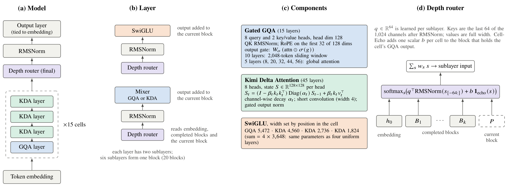
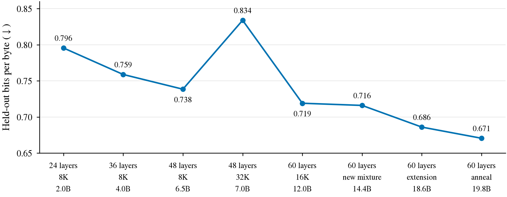
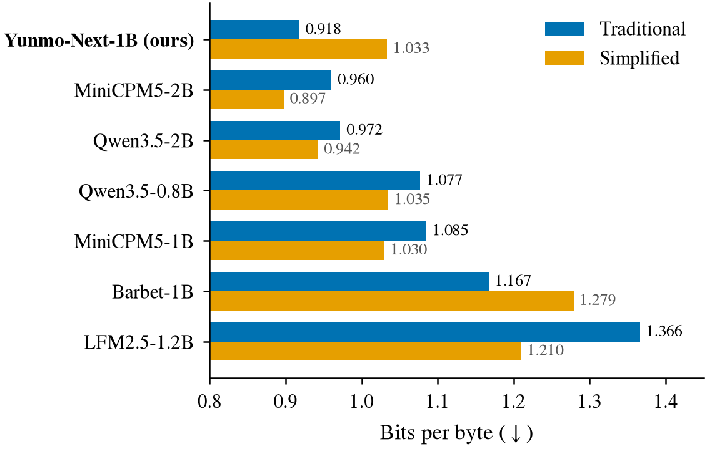
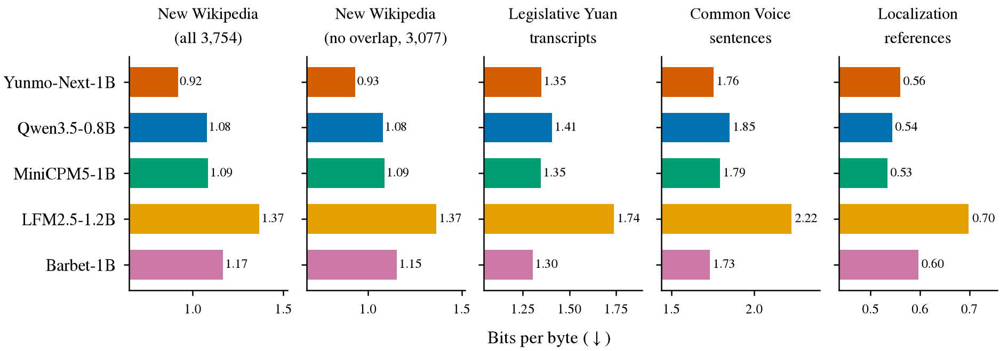
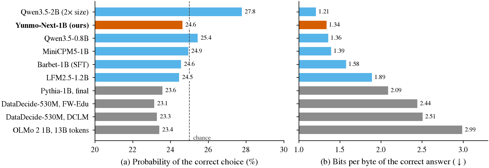
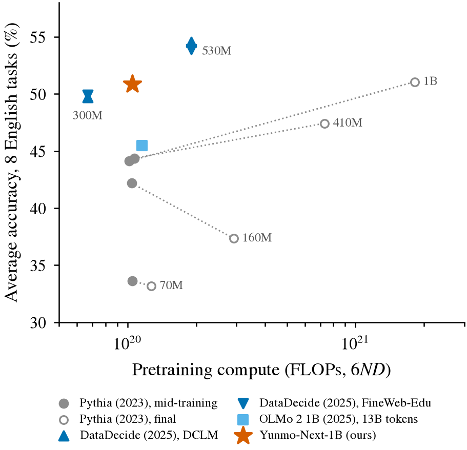
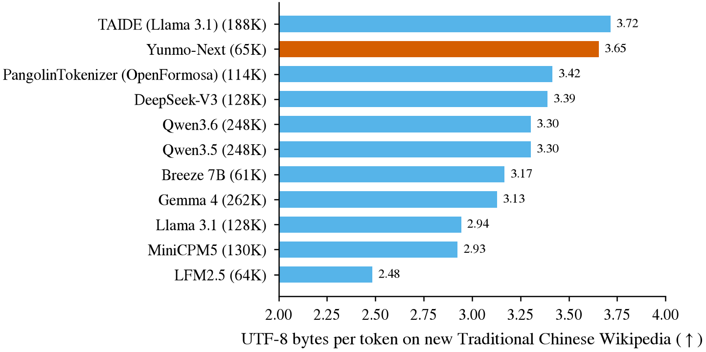
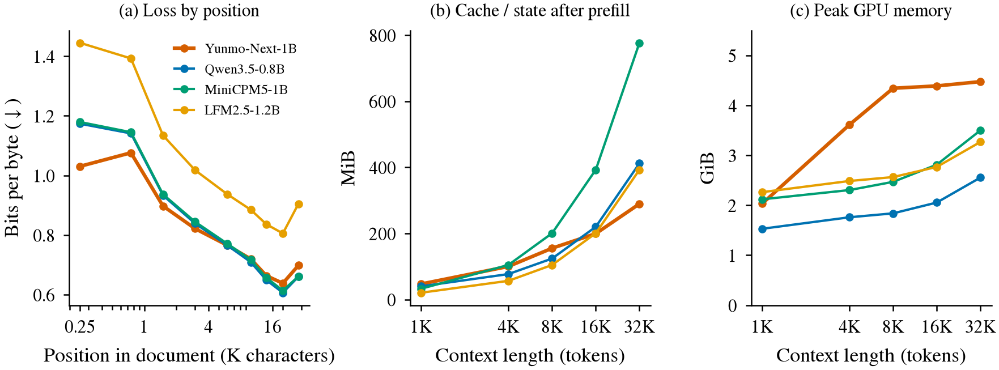
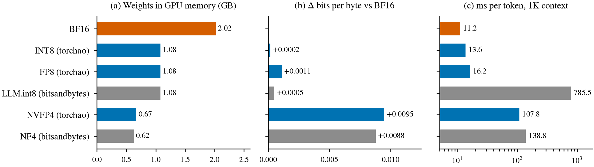

# Yunmo-Next-1B

*Technical overview · November 2026* · [繁體中文](overview.zh-TW.md)

Yunmo-Next-1B is a 1.0B-parameter language model for Traditional Chinese, trained from scratch. It uses a
hybrid of Kimi Delta Attention and grouped-query attention, was grown in depth from 24 to 60 layers during
pretraining, and was trained on 19.76B tokens on a single RTX 4070 Ti (12 GB) and a rented RTX 5090. We
release the base and instruction-tuned models, quantized checkpoints, the tokenizer, training and
inference code, data recipes, and all evaluation outputs under Apache-2.0.

## Highlights

- **Traditional Chinese text.** On 3,754 Chinese Wikipedia articles created after every compared model's
  training data, Yunmo-Next-1B-Base has lower bits per byte than all six other open-weight models compared,
  including two 2B models (0.918 vs 0.960 for the next best), also after removing articles that overlap its
  training data.
  Outside Wikipedia it is on par with the strongest 1B models rather than ahead.
- **Compute efficiency.** Pretraining used about 1.05×10²⁰ FLOPs. At that compute it is ahead of every Pythia
  checkpoint and of an OLMo 2 checkpoint on eight English tasks, and between the annealed 300M and 530M
  DataDecide models of 2025, while spending most of its tokens on Chinese.
- **Tokenizer.** The 65,536-entry tokenizer needs fewer tokens than OpenFormosa's PangolinTokenizer on all
  seven out-of-domain sets measured, with 57% of its vocabulary.
- **Small-memory architecture.** 45 of 60 layers are KDA with fixed-size state; only 5 layers keep a cache
  that grows with context. The 60-layer model trains at 16K context in 9.8 GB.
- **Deployment.** CUDA-graph decoding (11–12 ms per token in BF16; 66 tokens/s end to end in FP32 chat),
  continuous batching at 485 tokens/s, plain `transformers` loading with a chat template, quantized
  checkpoints in INT8, FP8, NVFP4 and NF4 with measured quality and speed, and an MLX port for Apple silicon.

Knowledge-heavy benchmarks are the main limitation: multiple-choice MMLU and TMMLU+ are at chance for the base
model, and 2026 models of similar size trained on far more tokens score much higher (see
[Limitations](#limitations)).

## Models

| Model | Description | Weights |
|---|---|---|
| [Yunmo-Next-1B-Base](https://huggingface.co/yuhuanstudio/Yunmo-Next-1B-Base) | Pretrained model | FP32, BF16 |
| [Yunmo-Next-1B-Instruct](https://huggingface.co/yuhuanstudio/Yunmo-Next-1B-Instruct) | Supervised fine-tuning, chat protocol, reasoning effort, tool calls | FP32, BF16 |
| [Yunmo-Next-1B-Instruct-INT8](https://huggingface.co/yuhuanstudio/Yunmo-Next-1B-Instruct-INT8) | torchao INT8 weight-only | 1.08 GB |
| [Yunmo-Next-1B-Instruct-FP8](https://huggingface.co/yuhuanstudio/Yunmo-Next-1B-Instruct-FP8) | torchao FP8, dynamic activations | 1.08 GB |
| [Yunmo-Next-1B-Instruct-NVFP4](https://huggingface.co/yuhuanstudio/Yunmo-Next-1B-Instruct-NVFP4) | torchao NVFP4 weight-only | 0.67 GB |
| [Yunmo-Next-1B-Instruct-bnb-4bit](https://huggingface.co/yuhuanstudio/Yunmo-Next-1B-Instruct-bnb-4bit) | bitsandbytes NF4 | 0.62 GB |
| [Yunmo-Next-1B-Base-bnb-4bit](https://huggingface.co/yuhuanstudio/Yunmo-Next-1B-Base-bnb-4bit) | bitsandbytes NF4 | 0.62 GB |
| Yunmo-Next-1B-{Base,Instruct}-MLX-{bf16,8bit,4bit} | MLX, for Apple silicon (6 repositories) | 2.0 / 1.1 / 0.67 GB |
| [Yunmo-Next-Tokenizer](https://huggingface.co/yuhuanstudio/Yunmo-Next-Tokenizer) | 65,536-entry BPE tokenizer | — |

## Architecture

| | |
|---|---|
| Parameters | 1.008B (embedding tied with the output projection) |
| Layers | 60, as 15 four-layer cells: one GQA layer followed by three KDA layers |
| Attention | 15 GQA layers (10 with a 2,048-token sliding window, 5 global), 8 query and 2 KV heads of dimension 128, partial RoPE |
| Linear attention | 45 KDA layers, 8 heads, 128 × 128 state per head |
| Hidden size | 1,024 |
| Feed-forward | SwiGLU; width follows the cell position (5,472 / 4,560 / 2,736 / 1,824) |
| Depth routing | Low-rank Block Attention Residuals with Cell-Echo |
| Vocabulary | 65,536 (256 reserved protocol tokens) |
| Context | 16,384 tokens trained |



*Figure 1. (a) The model: 15 cells of one GQA layer and three KDA layers. (b) Each layer has two sublayers, each reading its input through a depth router. (c) Layer components. (d) The depth router over the embedding, completed blocks and the current block.*

Each sublayer reads its input through a learned softmax over earlier block outputs instead of a single
residual sum (Block Attention Residuals). Keys use 64 of the 1,024 channels, and keys are recomputed per
block in the backward pass, so routing adds little memory. Each choice was selected with paired training runs
scored on held-out bits per byte; the [architecture report](architecture.md) lists the experiments and the
rejected variants.

## Training

| | |
|---|---|
| Tokens | 19.76B |
| Compute | about 1.05×10²⁰ FLOPs |
| Hardware | RTX 4070 Ti 12 GB (10.3B tokens); rented RTX 5090 (9.4B tokens, 230 hours, about NT$2,800) |
| Depth growth | 24 → 36 → 48 → 60 layers, adding whole cells |
| Context | 8K → 32K → 16K |
| Batch | 65,536 tokens per update |
| Optimizer | Muon variants for matrices, AdamW for embeddings, norms and scalars |
| Precision | BF16 weights without FP32 master copies; FP16 Kahan compensation |
| Data | Traditional-Chinese-first mixture: web, Wikipedia, classical texts, government documents, English educational web, mathematics, code |



*Figure 2. Held-out bits per byte (8K context, 125 documents) at the end of each training stage. The 32K stage raised short-context BPB; the 60-layer stage recovered it.*

The data mixture, its licenses and its known limitations are in the [data report](data.md); the route,
optimizer, schedule and memory techniques in the [training report](training.md).

The instruction-tuned model was fine-tuned on 1.76B tokens (0.8B supervised) with a message protocol, four
reasoning-effort levels and tool calls ([instruction-tuning report](instruct.md)).

## Evaluation

### Traditional Chinese text

Bits per byte on Chinese Wikipedia articles created after 2026-10-01 (lower is better; independent of the
tokenizer). The Simplified column scores the same articles in Simplified script.



*Figure 3. Bits per byte on 3,754 Chinese Wikipedia articles created after 2026-10-01, in Traditional and Simplified script.*

| Model | Traditional | Traditional, headings removed | Simplified |
|---|---:|---:|---:|
| **Yunmo-Next-1B-Base** | **0.918** | **0.941** | 1.033 |
| Yunmo-Next-1B-Instruct | 0.930 | 0.954 | 0.999 |
| MiniCPM5-2B-Base | 0.960 | 0.967 | **0.897** |
| Qwen3.5-2B-Base | 0.972 | 0.980 | 0.942 |
| Qwen3.5-0.8B-Base | 1.077 | 1.086 | 1.035 |
| MiniCPM5-1B-Base | 1.085 | 1.091 | 1.030 |
| Barbet 1B (OpenFormosa) | 1.167 | 1.167 | 1.279 |
| LFM2.5-1.2B-Base | 1.366 | 1.369 | 1.210 |

On Simplified text Yunmo-Next is level with the 0.8–1B models; the advantage is specific to Traditional
script ([evaluation §2](evaluation.md#2-traditional-chinese-text-written-after-every-models-training-data)).

Yunmo-Next was trained on Wikipedia, so we checked two things. Only 1.77% of the test characters occur in
25-character spans of our Wikipedia training data; on the 3,077 articles with no overlap it scores 0.932
against 0.964 for the next model. On three non-Wikipedia corpora published by OpenFormosa, the lead does not
carry over:



*Figure 4. Bits per byte on new Wikipedia articles (all, and with no overlap with our training data) and on
Legislative Yuan transcripts, Common Voice sentences and Taiwan localization references.*

| Model | Legislative Yuan | Common Voice | Localization |
|---|---:|---:|---:|
| **Yunmo-Next-1B-Base** | 1.348 | 1.755 | 0.560 |
| Qwen3.5-0.8B-Base | 1.406 | 1.852 | 0.544 |
| MiniCPM5-1B-Base | 1.346 | 1.794 | **0.534** |
| LFM2.5-1.2B-Base | 1.739 | 2.224 | 0.699 |
| Barbet 1B (OpenFormosa) | **1.303** | **1.733** | 0.597 |

Yunmo-Next is best on Traditional Chinese encyclopedic text and on par with MiniCPM5-1B elsewhere; Barbet,
whose training targets include transcripts of this kind, is best on the two spoken-language sets
([evaluation §2.4–2.5](evaluation.md#24-overlap-with-the-wikipedia-training-data)).

### Knowledge in cloze form

TMMLU+ and MMLU scored in cloze form (the text of each answer, OLMES-style) with the continuous metrics of
DataDecide ([evaluation §1.7](evaluation.md#17-cloze-formulation-and-continuous-metrics)):



*Figure 5. TMMLU+ in cloze form: (a) probability of the correct choice, normalized over the choices;
(b) bits per byte of the correct answer. Grey: English-only models at similar or larger compute.*

No model of 1.2B parameters or fewer shows TMMLU+ knowledge beyond chance, by accuracy (22.9–25.3%) or by the
normalized probability of the correct choice (23.1–25.4%; Yunmo-Next 24.6%). Yunmo-Next gives the correct
answer text the lowest bits per byte (1.337, against 1.357 for Qwen3.5-0.8B), but it does not prefer the
correct choice over the wrong ones, so this reflects how well it predicts Traditional Chinese, not knowledge.
On MMLU in cloze form it scores 29.3%, level with the final Pythia-1B and below the 2026 models (35.3–42.9%).

### Same compute

LFM2.5-1.2B, the one comparison model that states its token count, used about 1,900 times Yunmo-Next's
compute. At equal compute we compare with
Pythia checkpoints, the annealed DataDecide models (AI2, 2025) and an OLMo 2 1B checkpoint, in the same
harness ([evaluation §1.5–1.6](evaluation.md#16-same-compute-2025-references)):



*Figure 6. Average accuracy on eight English tasks against pretraining compute (6ND). Filled grey: Pythia
checkpoints at Yunmo-Next's compute; open grey: the same sizes after full training. DataDecide models are
fully trained; OLMo 2 is a mid-training checkpoint.*

| Model | Compute (FLOPs) | Average, 8 English tasks | XWinograd-zh |
|---|---:|---:|---:|
| **Yunmo-Next-1B-Base** | 1.05×10²⁰ | 50.9 | **67.5** |
| DataDecide 300M (FineWeb-Edu / DCLM) | 0.67×10²⁰ | 49.9 / 49.7 | 52.8 / 53.0 |
| DataDecide 530M (FineWeb-Edu / DCLM) | 1.90×10²⁰ | 53.9 / **54.6** | 52.6 / 53.8 |
| OLMo 2 1B, 13B tokens | 1.16×10²⁰ | 45.5 | 51.8 |
| Best Pythia at equal compute (410M, step 21,000) | 1.07×10²⁰ | 44.4 | 52.0 |
| Pythia-1B, final | 18.2×10²⁰ | 51.1 | 59.1 |

Yunmo-Next sits between the two DataDecide sizes, which were trained only on English, while about 70% of
its own tokens were Chinese or code. The comparison covers the whole recipe, data included, not the
architecture alone.

### Base model benchmarks

lm-evaluation-harness, 0-shot (MMLU 5-shot) ([evaluation §1](evaluation.md#1-comparison-with-2026-open-base-models)):

| Task | Yunmo-Next 1B | Qwen3.5 0.8B | LFM2.5 1.2B | MiniCPM5 1B | Qwen3.5 2B | MiniCPM5 2B |
|---|---:|---:|---:|---:|---:|---:|
| Training tokens | 0.02T | — | 28T | — | — | — |
| ARC-Easy | 50.3 | 67.2 | 77.7 | 65.6 | 71.4 | 74.7 |
| HellaSwag | 41.3 | 54.9 | 59.2 | 56.8 | 66.0 | 67.3 |
| Winogrande | 56.1 | 60.2 | 58.7 | 58.2 | 64.6 | 63.5 |
| MMLU | 22.9 | 48.4 | 55.0 | 43.5 | 54.0 | 65.3 |
| TMMLU+ | 25.0 | 31.2 | 31.2 | 28.4 | 42.1 | 44.1 |
| XStoryCloze-zh | 57.5 | 58.3 | 58.5 | 58.0 | 62.3 | 63.6 |
| XCOPA-zh | 61.8 | 63.4 | 60.8 | 62.4 | 67.8 | 67.0 |
| XWinograd-zh | 67.5 | 68.8 | 63.1 | 71.6 | 77.4 | 74.6 |

### Instruct model benchmarks

Chat mode, answering directly ([instruction-tuning report](instruct.md)):

| | IFEval | GSM8K | HumanEval | MMLU | TMMLU+ |
|---|---:|---:|---:|---:|---:|
| **Yunmo-Next-1B-Instruct** | 44.7 | 13.9 | 15.9 | 29.0 | 23.0 |
| Qwen3.5 0.8B | 51.9 | 55.6 | 31.7 | 53.5 | 32.2 |
| LFM2.5 1.2B | 80.8 | 76.1 | 51.8 | 51.6 | 30.4 |
| MiniCPM5 1B | 63.6 | 57.8 | 61.6 | 53.3 | 26.1 |

### Tokenizer

Text per token relative to OpenFormosa's PangolinTokenizer, on text neither tokenizer was trained on
([tokenizer §6.4](tokenizer.md#64-out-of-distribution-text-including-openformosas-corpora)):



*Figure 7. UTF-8 bytes per token on new Traditional Chinese Wikipedia text (vocabulary size in parentheses).*

| Domain | Yunmo-Next vs PangolinTokenizer |
|---|---:|
| New Wikipedia articles, Traditional | +7.0% |
| New Wikipedia articles, Simplified | +4.2% |
| Legislative Yuan transcripts | +11.9% |
| Common Voice zh-TW sentences | +4.2% |
| Taiwan localization references | +14.3% |
| Translated web text | +19.4% |
| Translated code | +31.4% |

### Long context and memory

Against the comparison models on one RTX 4070 Ti, batch 1, BF16
([evaluation §3.4](evaluation.md#34-long-context-against-the-comparison-models)):



*Figure 8. (a) Bits per byte by position in long new Wikipedia articles. (b) Cache and recurrent state after
prefill. (c) Peak GPU memory.*

- Yunmo-Next keeps the smallest state at 32K context (290 MiB against 393–777 MiB), but has the highest
  peak memory (4.5 GiB against 2.6–3.5 GiB), and its prefill is slower at short context.
- It predicts the beginning of documents better; from about 4,000 characters Qwen3.5-0.8B and MiniCPM5-1B
  are level, and beyond about 12,000 characters slightly better.
- With CUDA graphs it decodes at 11–12 ms per token (BF16) from 1K to 32K context.

### Quantized weights

Yunmo-Next-1B-Instruct, bits per byte on the new Wikipedia articles and decode latency at 1K context
([evaluation §6](evaluation.md#6-quantized-weights)):



*Figure 9. (a) Loss increase against weight memory. (b) Decode latency, batch 1, RTX 4070 Ti (log scale).*

| Format | Weights | Bits per byte | Δ vs BF16 | ms / token |
|---|---:|---:|---:|---:|
| BF16 | 2.02 GB | 0.9302 | — | 11.2 |
| INT8 (torchao) | 1.08 GB | 0.9304 | +0.0002 | 13.6 |
| FP8 (torchao) | 1.08 GB | 0.9313 | +0.0011 | 16.2 |
| NVFP4 (torchao) | 0.67 GB | 0.9397 | +0.0095 | 107.8 |
| NF4 (bitsandbytes) | 0.62 GB | 0.9390 | +0.0088 | 138.8 |

INT8 is effectively lossless and keeps the fast decoder; 4-bit formats cost about 1% in loss. NVFP4 is
dequantized in software on this GPU and needs Blackwell-class hardware for native FP4 speed. There is no
GGUF version, because llama.cpp does not implement this architecture.

## Quickstart

Requires a CUDA GPU (the KDA layers run on Triton kernels from flash-linear-attention).

```bash
pip install "transformers>=5.14,<6" "flash-linear-attention==0.5.2"
```

```python
import torch
from transformers import AutoModelForCausalLM, AutoTokenizer

repo = "yuhuanstudio/Yunmo-Next-1B-Instruct"
tokenizer = AutoTokenizer.from_pretrained(repo, trust_remote_code=True)
model = AutoModelForCausalLM.from_pretrained(repo, trust_remote_code=True, dtype=torch.float32).cuda().eval()

messages = [{"role": "user", "content": "請用三句話介紹玉山。"}]
ids = tokenizer.apply_chat_template(messages, add_generation_prompt=True, return_tensors="pt",
                                    return_dict=True)["input_ids"].cuda()
stop = tokenizer.convert_tokens_to_ids("<|return|>")
out = model.generate(ids, max_new_tokens=256, stop_token_ids=(stop,))
print(tokenizer.decode(out[0, ids.shape[1]:], skip_special_tokens=True))
```

Notebooks:

- [Quickstart](https://github.com/YuhuanStudio/Yunmo-Next/blob/main/notebooks/01_quickstart.ipynb): base
  completion, scoring text in bits per byte, chat through `transformers` or the bundled runtime (reasoning
  effort, batched chat), quantized weights.
- [Continued pretraining and fine-tuning](https://github.com/YuhuanStudio/Yunmo-Next/blob/main/notebooks/02_continued_pretraining_and_sft.ipynb):
  full-parameter continued pretraining and supervised fine-tuning on one 12 GB GPU.

## Limitations

- **Knowledge.** The base model is at chance on letter-scored MMLU and TMMLU+ (its cloze-form MMLU, 29.3%, is
  level with the final Pythia-1B), and the instruct model trails
  2026 models of similar size on every chat benchmark, by 3–62 points. These benchmarks track training tokens,
  and the compared models were trained on up to about 1,400 times more.
- **Factual accuracy.** Generated text is fluent but often wrong on facts, for example the height of Yushan
  ("1,965 m" instead of 3,952 m) when continuing "玉山是臺灣最高的山，". Do not rely on it as a source.
- **Long context.** Trained at up to 16K tokens, it uses distant context less than the comparison models and
  fails most retrieval probes beyond 8K.
- **Reasoning.** GSM8K is 13.9%. Reasoning effort `medium` and `high` scored lower than answering directly
  (`none`) on every benchmark; `low` was ahead only on GSM8K, by 1.1 points.
- **Hardware.** The PyTorch release requires a CUDA GPU. The MLX port runs on Apple silicon but was validated
  numerically on Linux and has not been timed on a Mac; there is no CPU path in PyTorch and no GGUF version.
- **Data.** Much of the Traditional Chinese data was converted from Simplified with OpenCC; the share of text
  originally written in Traditional Chinese is not resolved ([data report](data.md)).
- The models have not been safety-tuned beyond the supervised data and should not be used for decisions that
  affect people.

## Resources

| | |
|---|---|
| Code | [YuhuanStudio/Yunmo-Next](https://github.com/YuhuanStudio/Yunmo-Next) |
| Technical report (PDF) | [yunmo-next-1b.pdf](../paper/yunmo-next-1b.pdf) |
| Detailed reports | [architecture](architecture.md) · [training](training.md) · [data](data.md) · [tokenizer](tokenizer.md) · [evaluation](evaluation.md) · [instruction tuning](instruct.md) |
| Evaluation outputs | [`data/`](../data) |
| Wikipedia corpus | [yuhuanstudio/wikipedia-zh-tw](https://huggingface.co/datasets/yuhuanstudio/wikipedia-zh-tw) |

## Citation

```bibtex
@misc{yunmonext2026,
  title  = {Yunmo-Next-1B: A Traditional Chinese Language Model Trained on a Single Consumer GPU},
  author = {YuhuanStudio},
  year   = {2026},
  url    = {https://github.com/YuhuanStudio/Yunmo-Next}
}
```
