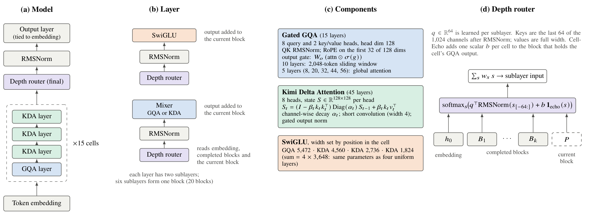
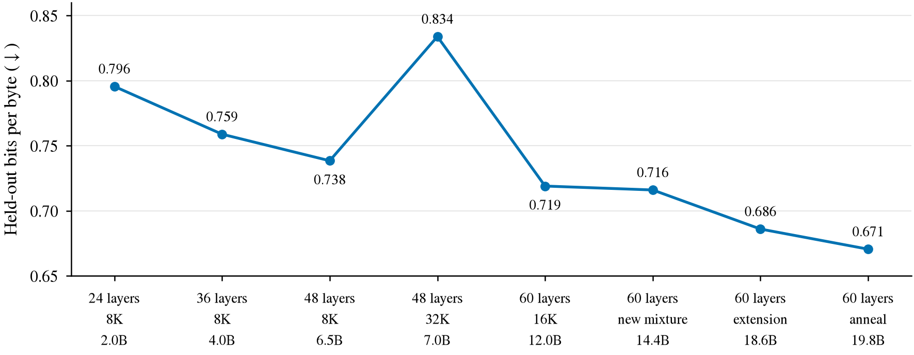
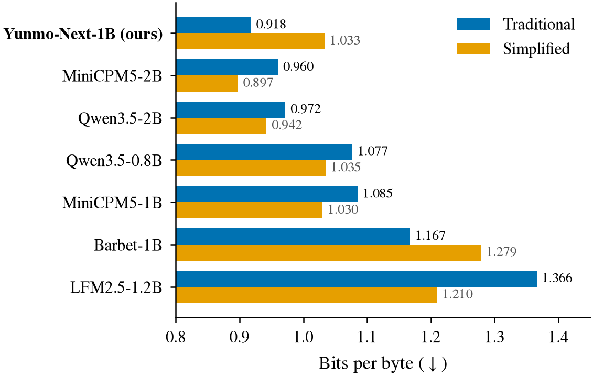
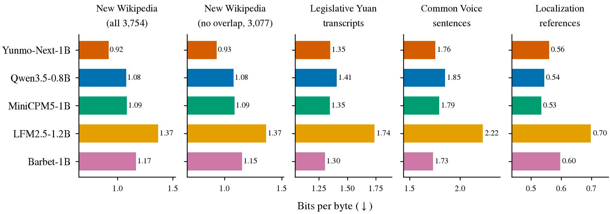
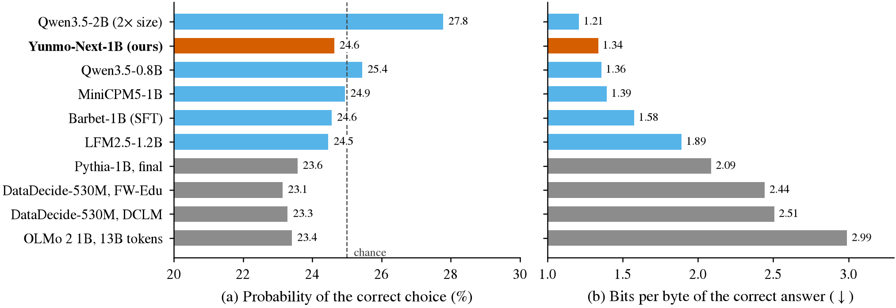
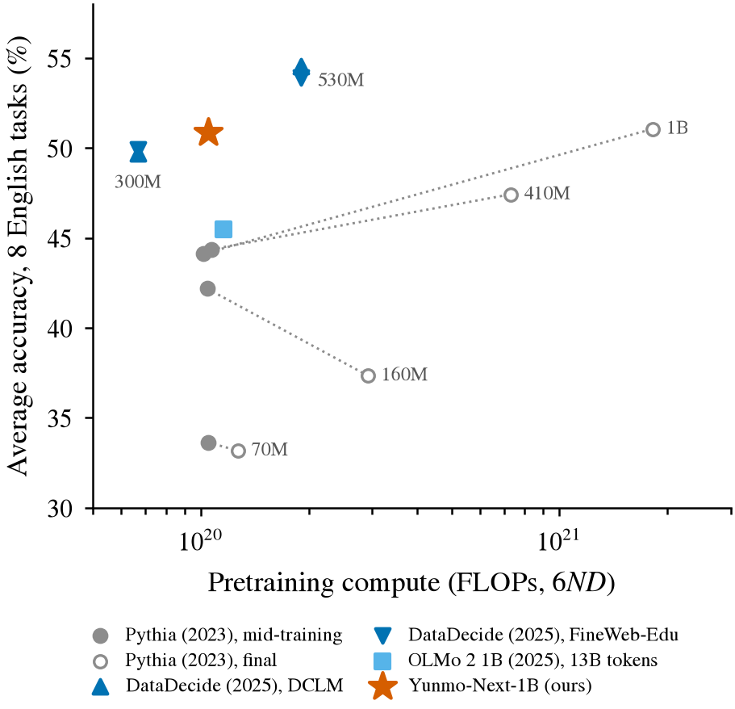
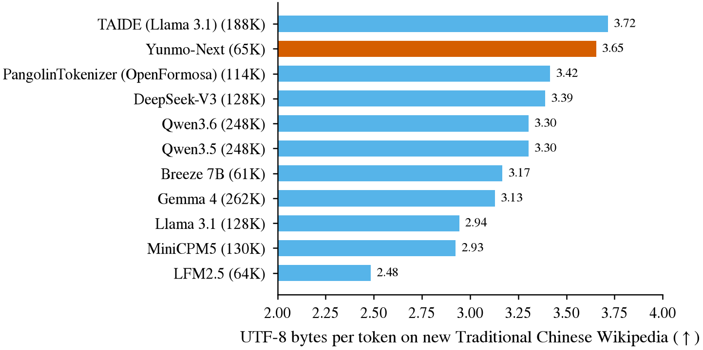
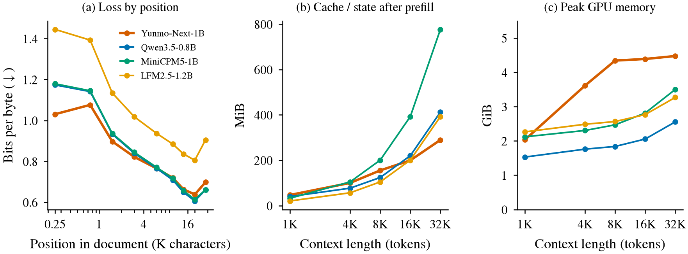
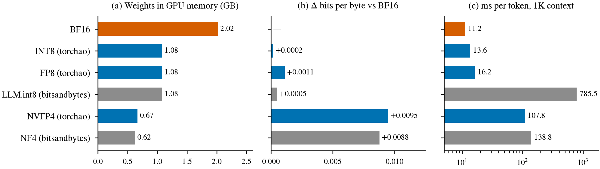

# Yunmo-Next-1B

*技術總覽 · 2026 年 11 月* · [English](overview.md)

Yunmo-Next-1B 是從零訓練、以繁體中文為主的 1.0B 參數語言模型。架構混合 Kimi Delta Attention 與 grouped-query
attention，預訓練過程中從 24 層加深到 60 層，在一張 RTX 4070 Ti（12 GB）與租用的 RTX 5090 上訓練了 19.76B
tokens。我們以 Apache-2.0 公開 Base 與 Instruct 模型、量化版、tokenizer、訓練與推論程式碼、資料配方，以及所有評測輸出。

## 重點

- **繁體中文文字。** 在 3,754 篇在所有對照模型的訓練資料截止後才建立的中文維基條目上，Yunmo-Next-1B-Base 的 bits per
  byte 低於其他六個開放權重模型，包括兩個 2B 模型（0.918，次佳為 0.960）；排除與訓練資料重疊的條目後仍是如此。在維基以外的文字上，則與最強的 1B 模型相當，沒有領先。
- **計算效率。** 預訓練約用 1.05×10²⁰ FLOPs。在這個計算量下，八項英文任務的平均領先每一個 Pythia checkpoint 與一個 OLMo 2 checkpoint，並落在經退火的 2025 年 DataDecide 300M 與 530M 模型之間，而且大部分 token 用在中文上。
- **Tokenizer。** 詞表大小 65,536 的 tokenizer 在量測的七個領域外文字集上，所需 token 都比 OpenFormosa 的
  PangolinTokenizer 少，詞表只有它的 57%。
- **小記憶體架構。** 60 層中 45 層是狀態大小固定的 KDA，只有 5 層的快取會隨上下文增長。60 層模型以 16K
  上下文訓練，峰值記憶體 9.8 GB。
- **部署。** CUDA graph 解碼（BF16 每個 token 11–12 ms；FP32 對話端到端 66 tokens/s）、連續批次 485 tokens/s，可直接用 `transformers` 載入並使用 chat template；提供 INT8、FP8、NVFP4、NF4 量化版，每種都附實測品質與速度，另有 Apple silicon 用的 MLX 版。

主要限制在知識類基準測試：Base 模型在選擇題 MMLU 與 TMMLU+ 上是隨機水準，訓練 token 多得多的同尺寸 2026 年模型分數高很多（見[限制](#限制)）。

## 模型

| 模型 | 說明 | 權重 |
|---|---|---|
| [Yunmo-Next-1B-Base](https://huggingface.co/yuhuanstudio/Yunmo-Next-1B-Base) | 預訓練模型 | FP32、BF16 |
| [Yunmo-Next-1B-Instruct](https://huggingface.co/yuhuanstudio/Yunmo-Next-1B-Instruct) | 監督式微調；對話協定、推理強度、工具呼叫 | FP32、BF16 |
| [Yunmo-Next-1B-Instruct-INT8](https://huggingface.co/yuhuanstudio/Yunmo-Next-1B-Instruct-INT8) | torchao INT8 僅量化權重 | 1.08 GB |
| [Yunmo-Next-1B-Instruct-FP8](https://huggingface.co/yuhuanstudio/Yunmo-Next-1B-Instruct-FP8) | torchao FP8，激活值動態量化 | 1.08 GB |
| [Yunmo-Next-1B-Instruct-NVFP4](https://huggingface.co/yuhuanstudio/Yunmo-Next-1B-Instruct-NVFP4) | torchao NVFP4 僅量化權重 | 0.67 GB |
| [Yunmo-Next-1B-Instruct-bnb-4bit](https://huggingface.co/yuhuanstudio/Yunmo-Next-1B-Instruct-bnb-4bit) | bitsandbytes NF4 | 0.62 GB |
| [Yunmo-Next-1B-Base-bnb-4bit](https://huggingface.co/yuhuanstudio/Yunmo-Next-1B-Base-bnb-4bit) | bitsandbytes NF4 | 0.62 GB |
| Yunmo-Next-1B-{Base,Instruct}-MLX-{bf16,8bit,4bit} | MLX，Apple silicon 用（6 個 repo） | 2.0 / 1.1 / 0.67 GB |
| [Yunmo-Next-Tokenizer](https://huggingface.co/yuhuanstudio/Yunmo-Next-Tokenizer) | 65,536 個 token 的 BPE tokenizer | — |

## 架構

| | |
|---|---|
| 參數 | 1.008B（embedding 與輸出投影共用） |
| 層數 | 60 層，由 15 個四層單元組成：一層 GQA 接三層 KDA |
| 注意力 | 15 層 GQA（10 層 2,048 token 滑動視窗、5 層全域），8 個 query head、2 個 KV head，維度 128，部分 RoPE |
| 線性注意力 | 45 層 KDA，8 個 head，每個 head 狀態 128 × 128 |
| 隱藏維度 | 1,024 |
| 前饋層 | SwiGLU，寬度隨單元內位置變化（5,472 / 4,560 / 2,736 / 1,824） |
| 深度路由 | 低秩 Block Attention Residuals 加 Cell-Echo |
| 詞表 | 65,536（含 256 個保留協定 token） |
| 上下文 | 訓練長度 16,384 tokens |



*圖 1：（a）模型：15 個單元，每個單元一層 GQA 接三層 KDA。（b）每層有兩個子層，各自經深度路由取得輸入。（c）各層元件。（d）深度路由：對 embedding、已完成區塊與目前區塊做加權。*

每個子層以可學習的 softmax 對前面各區塊的輸出加權，作為輸入，而不是單一殘差累加（Block Attention Residuals）。key 只用
1,024 個通道中的 64 個，反向傳播時逐區塊重算 key，因此路由幾乎不增加記憶體。每個設計都以成對訓練、比較
held-out bits per byte 決定；[架構報告](architecture.md)列出相關實驗與被淘汰的方案。

## 訓練

| | |
|---|---|
| Token 數 | 19.76B |
| 計算量 | 約 1.05×10²⁰ FLOPs |
| 硬體 | RTX 4070 Ti 12 GB（10.3B tokens）；租用 RTX 5090（9.4B tokens，230 小時，約新臺幣 2,800 元） |
| 深度成長 | 24 → 36 → 48 → 60 層，每次加整個單元 |
| 上下文 | 8K → 32K → 16K |
| 批次大小 | 每次更新 65,536 tokens |
| 最佳化器 | 矩陣用 Muon 系列，embedding、norm 與純量用 AdamW |
| 精度 | BF16 權重，不保留 FP32 主權重副本；FP16 Kahan 補償 |
| 資料 | 繁體中文優先的混合：網頁、維基百科、古籍、政府文件、英文教育網頁、數學、程式碼 |



*圖 2：每個訓練階段結束時的 held-out bits per byte（8K 上下文、125 篇文件）。32K 階段使短上下文 BPB 變差，60 層階段補回。*

資料配方、授權與已知限制見[資料報告](data.md)；訓練路線、最佳化器、排程與記憶體技術見[訓練報告](training.md)。

Instruct 模型以 1.76B tokens（其中 0.8B 為監督 token）微調，包含訊息協定、四檔推理強度與工具呼叫（[指令微調報告](instruct.md)）。

## 評測

### 繁體中文文字

2026-10-01 之後建立的中文維基條目上的 bits per byte（越低越好，不受 tokenizer 影響）。「簡體」欄是同一批條目的簡體版本。



*圖 3：2026-10-01 之後建立的 3,754 篇中文維基條目上的 bits per byte，繁體與簡體版本。*

| 模型 | 繁體 | 繁體，去掉章節標題 | 簡體 |
|---|---:|---:|---:|
| **Yunmo-Next-1B-Base** | **0.918** | **0.941** | 1.033 |
| Yunmo-Next-1B-Instruct | 0.930 | 0.954 | 0.999 |
| MiniCPM5-2B-Base | 0.960 | 0.967 | **0.897** |
| Qwen3.5-2B-Base | 0.972 | 0.980 | 0.942 |
| Qwen3.5-0.8B-Base | 1.077 | 1.086 | 1.035 |
| MiniCPM5-1B-Base | 1.085 | 1.091 | 1.030 |
| Barbet 1B（OpenFormosa） | 1.167 | 1.167 | 1.279 |
| LFM2.5-1.2B-Base | 1.366 | 1.369 | 1.210 |

在簡體文字上，Yunmo-Next 與 0.8–1B 模型持平；這項優勢只出現在繁體文字上（[評測報告 §2](evaluation.md#2-traditional-chinese-text-written-after-every-models-training-data)）。

Yunmo-Next 的訓練資料包含維基百科，所以我們檢查了兩件事。測試文字中只有 1.77% 的字元出現在訓練用維基的
25 字片段裡；在 3,077 篇完全沒有重疊的條目上，它的 bits per byte 為 0.932，次佳模型為 0.964。換到 OpenFormosa 公開的三組非維基文字，領先並未延續：



*圖 4：新維基條目（全部，以及與訓練資料無重疊者）與立法院逐字稿、Common Voice 句子、臺灣在地化參考譯文上的 bits per byte。*

| 模型 | 立法院逐字稿 | Common Voice | 臺灣在地化參考譯文 |
|---|---:|---:|---:|
| **Yunmo-Next-1B-Base** | 1.348 | 1.755 | 0.560 |
| Qwen3.5-0.8B-Base | 1.406 | 1.852 | 0.544 |
| MiniCPM5-1B-Base | 1.346 | 1.794 | **0.534** |
| LFM2.5-1.2B-Base | 1.739 | 2.224 | 0.699 |
| Barbet 1B（OpenFormosa） | **1.303** | **1.733** | 0.597 |

Yunmo-Next 在繁體中文百科文字上最好，其他文字則與 MiniCPM5-1B 相當；Barbet 的訓練目標包含這類逐字稿，在兩組口語文字上最好（[評測報告 §2.4–2.5](evaluation.md#24-overlap-with-the-wikipedia-training-data)）。

### 克漏字形式的知識測驗

以克漏字（cloze）形式（對每個答案的文字評分，OLMES 做法）加上 DataDecide 的連續指標評 TMMLU+ 與 MMLU（[評測報告 §1.7](evaluation.md#17-cloze-formulation-and-continuous-metrics)）：



*圖 5：TMMLU+ 克漏字形式。（a）正確選項的機率（在各選項間正規化）。（b）正確答案的 bits per byte。灰色為計算量相近或更大、只用英文訓練的模型。*

1.2B 以下的模型在 TMMLU+ 上都沒有超過隨機水準的知識：正確率 22.9–25.3%，正規化後正確選項的機率 23.1–25.4%（Yunmo-Next 為 24.6%）。Yunmo-Next 對正確答案文字的 bits per byte 最低（1.337，Qwen3.5-0.8B 為 1.357），但它並沒有比較偏好正確選項，所以這反映的是它預測繁體中文的能力，不是知識。克漏字形式的 MMLU 為 29.3%，與最終版 Pythia-1B 相當，低於 2026 年的模型（35.3–42.9%）。

### 相同計算量

對照模型中只有 LFM2.5-1.2B 公開訓練 token 數，計算量約為 Yunmo-Next 的 1,900 倍。在相同計算量下，我們用同一套評測工具比較 Pythia checkpoint、經退火的 DataDecide 模型（AI2，2025）與一個 OLMo 2 1B checkpoint
（[評測報告 §1.5–1.6](evaluation.md#16-same-compute-2025-references)）：



*圖 6：八項英文任務平均正確率與預訓練計算量（6ND）的關係。實心灰點：與 Yunmo-Next 同計算量的 Pythia checkpoint；空心灰點：同尺寸完整訓練後。DataDecide 為訓練完成並經退火的模型；OLMo 2 為訓練中途的 checkpoint。*

| 模型 | 計算量（FLOPs） | 八項英文平均 | XWinograd-zh |
|---|---:|---:|---:|
| **Yunmo-Next-1B-Base** | 1.05×10²⁰ | 50.9 | **67.5** |
| DataDecide 300M（FineWeb-Edu / DCLM） | 0.67×10²⁰ | 49.9 / 49.7 | 52.8 / 53.0 |
| DataDecide 530M（FineWeb-Edu / DCLM） | 1.90×10²⁰ | 53.9 / **54.6** | 52.6 / 53.8 |
| OLMo 2 1B，13B tokens | 1.16×10²⁰ | 45.5 | 51.8 |
| 同計算量最佳 Pythia（410M，step 21,000） | 1.07×10²⁰ | 44.4 | 52.0 |
| Pythia-1B 最終版 | 18.2×10²⁰ | 51.1 | 59.1 |

Yunmo-Next 落在兩個 DataDecide 尺寸之間；它們只用英文訓練，而 Yunmo-Next 約 70% 的 token 是中文或程式碼。這比較的是包含資料在內的整套配方，不只是架構。

### Base 模型基準測試

lm-evaluation-harness，0-shot（MMLU 為 5-shot；見[評測報告 §1](evaluation.md#1-comparison-with-2026-open-base-models)）：

| 任務 | Yunmo-Next 1B | Qwen3.5 0.8B | LFM2.5 1.2B | MiniCPM5 1B | Qwen3.5 2B | MiniCPM5 2B |
|---|---:|---:|---:|---:|---:|---:|
| 訓練 tokens | 0.02T | — | 28T | — | — | — |
| ARC-Easy | 50.3 | 67.2 | 77.7 | 65.6 | 71.4 | 74.7 |
| HellaSwag | 41.3 | 54.9 | 59.2 | 56.8 | 66.0 | 67.3 |
| Winogrande | 56.1 | 60.2 | 58.7 | 58.2 | 64.6 | 63.5 |
| MMLU | 22.9 | 48.4 | 55.0 | 43.5 | 54.0 | 65.3 |
| TMMLU+ | 25.0 | 31.2 | 31.2 | 28.4 | 42.1 | 44.1 |
| XStoryCloze-zh | 57.5 | 58.3 | 58.5 | 58.0 | 62.3 | 63.6 |
| XCOPA-zh | 61.8 | 63.4 | 60.8 | 62.4 | 67.8 | 67.0 |
| XWinograd-zh | 67.5 | 68.8 | 63.1 | 71.6 | 77.4 | 74.6 |

### Instruct 模型基準測試

對話模式、直接作答（[指令微調報告](instruct.md)）：

| | IFEval | GSM8K | HumanEval | MMLU | TMMLU+ |
|---|---:|---:|---:|---:|---:|
| **Yunmo-Next-1B-Instruct** | 44.7 | 13.9 | 15.9 | 29.0 | 23.0 |
| Qwen3.5 0.8B | 51.9 | 55.6 | 31.7 | 53.5 | 32.2 |
| LFM2.5 1.2B | 80.8 | 76.1 | 51.8 | 51.6 | 30.4 |
| MiniCPM5 1B | 63.6 | 57.8 | 61.6 | 53.3 | 26.1 |

### Tokenizer

在兩個 tokenizer 都沒訓練過的文字上，每個 token 涵蓋的文字量，相對於 OpenFormosa 的 PangolinTokenizer
（[Tokenizer 報告 §6.4](tokenizer.md#64-out-of-distribution-text-including-openformosas-corpora)）：



*圖 7：繁體中文新維基條目上每個 token 的 UTF-8 bytes（括號內為詞表大小）。*

| 領域 | Yunmo-Next 對 PangolinTokenizer |
|---|---:|
| 新維基條目，繁體 | +7.0% |
| 新維基條目，簡體 | +4.2% |
| 立法院逐字稿 | +11.9% |
| Common Voice zh-TW 句子 | +4.2% |
| 臺灣在地化參考譯文 | +14.3% |
| 翻譯的網頁文字 | +19.4% |
| 翻譯的程式碼 | +31.4% |

### 長上下文與記憶體

與對照模型在同一張 RTX 4070 Ti 上比較，batch 1、BF16
（[評測報告 §3.4](evaluation.md#34-long-context-against-the-comparison-models)）：



*圖 8：（a）長篇新維基條目中各位置的 bits per byte。（b）prefill 後的快取與遞迴狀態。（c）GPU 峰值記憶體。*

- 在 32K 上下文時，Yunmo-Next 的狀態最小（290 MiB，其他模型 393–777 MiB），但峰值記憶體最高（4.5 GiB，其他
  2.6–3.5 GiB），短上下文的 prefill 也較慢。
- 文件開頭預測得比較好；約 4,000 字之後 Qwen3.5-0.8B 與 MiniCPM5-1B 追平，約 12,000 字之後略優於 Yunmo-Next。
- 使用 CUDA graph 時，在 1K 到 32K 上下文的解碼都是每個 token 11–12 ms（BF16）。

### 量化權重

Yunmo-Next-1B-Instruct 在新維基條目上的 bits per byte，以及 1K 上下文的解碼延遲（[評測報告 §6](evaluation.md#6-quantized-weights)）：



*圖 9：（a）損失增加量與權重記憶體的關係。（b）解碼延遲，batch 1，RTX 4070 Ti（對數座標）。*

| 格式 | 權重 | bits per byte | Δ（相對 BF16） | ms / token |
|---|---:|---:|---:|---:|
| BF16 | 2.02 GB | 0.9302 | — | 11.2 |
| INT8（torchao） | 1.08 GB | 0.9304 | +0.0002 | 13.6 |
| FP8（torchao） | 1.08 GB | 0.9313 | +0.0011 | 16.2 |
| NVFP4（torchao） | 0.67 GB | 0.9397 | +0.0095 | 107.8 |
| NF4（bitsandbytes） | 0.62 GB | 0.9390 | +0.0088 | 138.8 |

INT8 幾乎沒有損失，而且保留快速解碼器；4-bit 格式的 loss 約增加 1%。NVFP4 在這張 GPU 上是軟體反量化，要 Blackwell
等級的硬體才有原生 FP4 速度。沒有 GGUF 版本，因為 llama.cpp 沒有實作這個架構。

## 快速開始

需要 CUDA GPU（KDA 層使用 flash-linear-attention 的 Triton kernel）。

```bash
pip install "transformers>=5.14,<6" "flash-linear-attention==0.5.2"
```

```python
import torch
from transformers import AutoModelForCausalLM, AutoTokenizer

repo = "yuhuanstudio/Yunmo-Next-1B-Instruct"
tokenizer = AutoTokenizer.from_pretrained(repo, trust_remote_code=True)
model = AutoModelForCausalLM.from_pretrained(repo, trust_remote_code=True, dtype=torch.float32).cuda().eval()

messages = [{"role": "user", "content": "請用三句話介紹玉山。"}]
ids = tokenizer.apply_chat_template(messages, add_generation_prompt=True, return_tensors="pt",
                                    return_dict=True)["input_ids"].cuda()
stop = tokenizer.convert_tokens_to_ids("<|return|>")
out = model.generate(ids, max_new_tokens=256, stop_token_ids=(stop,))
print(tokenizer.decode(out[0, ids.shape[1]:], skip_special_tokens=True))
```

Notebook：

- [快速開始](https://github.com/YuhuanStudio/Yunmo-Next/blob/main/notebooks/01_quickstart.ipynb)：Base 續寫、以
  bits per byte 評分文字、透過 `transformers` 或內附 runtime 對話（推理強度、批次對話）、量化權重。
- [持續預訓練與微調](https://github.com/YuhuanStudio/Yunmo-Next/blob/main/notebooks/02_continued_pretraining_and_sft.ipynb)：在一張 12 GB GPU 上做全參數持續預訓練與監督式微調。

## 限制

- **知識。** Base 模型在以選項字母計分的 MMLU 與 TMMLU+ 上是隨機水準（克漏字形式的 MMLU 為 29.3%，與最終版
  Pythia-1B 相當）；Instruct 模型在每個對話基準測試上都落後同尺寸的 2026 年模型 3–62 分。這些基準測試反映訓練 token 數，而對照模型的訓練量最多約是我們的 1,400 倍。
- **事實正確性。** 生成的文字通順，但事實常常出錯，例如續寫「玉山是臺灣最高的山，」時寫出海拔「1,965 公尺」（實際為 3,952 公尺）。不應把它當作資料來源。
- **長上下文。** 訓練長度最多 16K，使用遠處上下文的能力不如對照模型，8K 以上的檢索測試大多失敗。
- **推理。** GSM8K 為 13.9%。推理強度 `medium` 與 `high` 在每個基準測試都比直接作答（`none`）低；`low` 只在 GSM8K 高 1.1 分。
- **硬體。** PyTorch 版需要 CUDA GPU。MLX 版可在 Apple silicon 上執行，但只在 Linux 上做過數值驗證，尚未在 Mac 上測速；PyTorch 沒有 CPU 路徑，也沒有 GGUF 版本。
- **資料。** 大量繁體中文資料由簡體經 OpenCC 轉換而來，原生繁體文字的比例尚未釐清（[資料報告](data.md)）。
- 模型除監督資料外沒有做安全調整，不應用於會影響人的決策。

## 資源

| | |
|---|---|
| 程式碼 | [YuhuanStudio/Yunmo-Next](https://github.com/YuhuanStudio/Yunmo-Next) |
| 技術報告（PDF） | [yunmo-next-1b.pdf](../paper/yunmo-next-1b.pdf) |
| 各章報告 | [架構](architecture.md) · [訓練](training.md) · [資料](data.md) · [tokenizer](tokenizer.md) · [評測](evaluation.md) · [指令微調](instruct.md) |
| 評測輸出 | [`data/`](../data) |
| 維基語料 | [yuhuanstudio/wikipedia-zh-tw](https://huggingface.co/datasets/yuhuanstudio/wikipedia-zh-tw) |

## 引用

```bibtex
@misc{yunmonext2026,
  title  = {Yunmo-Next-1B: A Traditional Chinese Language Model Trained on a Single Consumer GPU},
  author = {YuhuanStudio},
  year   = {2026},
  url    = {https://github.com/YuhuanStudio/Yunmo-Next}
}
```
